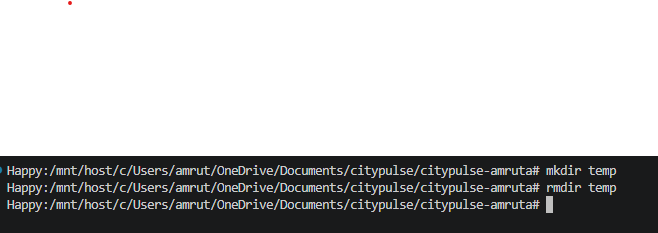

# citypulse-amruta

This repository documents basic Linux command-line tasks. Each task lists the commands to run, and the screenshots of my terminal output are added under each task.

## Task 1: Remove Directories

Use `mkdir` to create a directory and `rmdir` to remove an empty directory.

```bash
mkdir temp-dir
rmdir temp-dir
```

`rmdir` only works when the directory is empty. Use `rm -r` or `rm -rf` to remove directories that contain files or subdirectories.



## Task 2: Remove Files and Directories Recursively

Use `rm` to remove a file, and `rm -r` or `rm -rf` to remove a directory and everything inside it.

```bash
# Remove a file
rm filename.txt

# Remove a directory and its contents, asking before each deletion
rm -ri folder-name


# Remove a directory and its contents without prompting
rm -rf folder-name
```


**Warning:** `rm -rf` permanently deletes data. Double-check the path before running it.

<!-- Add screenshot here -->

## Task 3: Rename Files and Check Disk Usage

### Rename a File or Directory

The `mv` command renames a file or directory:

```bash
mv old-name.txt new-name.txt
mv old-folder-name new-folder-name
```

To move and rename a file at the same time:

```bash
mv filename.txt folder/new-filename.txt
```

### Check Disk Usage

Use `df -h` to see the disk space available on mounted filesystems:

```bash
df -h
```

Use `du` to show the size of files and directories:

```bash
# Show the size of every item in the current directory
du -h

# Show only a summary of the current directory
du -sh

# Show the size of a specific folder
du -sh folder-name
```

<!-- Add screenshot here -->

## Task 4: Linux Permissions

Linux files and directories have three permission types:

| Permission | Symbol | Meaning |
|------------|--------|---------|
| Read | `r` | View file contents or list directory contents |
| Write | `w` | Modify a file or change directory contents |
| Execute | `x` | Run a file as a program or enter a directory |

Permissions are assigned to:

- The file owner
- The owner's group
- Other users

Use `chmod` to change permissions:

```bash
# Add execute permission for the owner
chmod u+x script.sh

# Give the owner read and write permissions
chmod u+rw file.txt

# Make a file readable and writable by everyone
chmod 666 file.txt

# Give the owner full permissions and others read/execute permissions
chmod 755 script.sh
```

View permissions with:

```bash
ls -l
```

Example permission modes:

- `644`: owner can read/write; group and others can read
- `755`: owner can read/write/execute; group and others can read/execute
- `777`: all users have read, write, and execute permissions

<!-- Add screenshot here -->

## Task 5: List Running Processes

Use `ps` to view processes for the current terminal:

```bash
ps
```

Use `ps aux` to list processes from the entire system:

```bash
ps aux
```

To search for a specific process:

```bash
ps aux | grep process-name
```

An alternative, interactive process viewer is:

```bash
top
```

Press `q` to exit `top`.

<!-- Add screenshot here -->

## Screenshot Summary

| Screenshot | Description |
|------------|-------------|
| `task1.png` | Creating and removing a directory |
| `task2.png` | Removing files and directories |
| `task3.png` | Renaming files and checking disk usage |
| `task4.png` | Checking and changing permissions |
| `task5.png` | Listing running processes |